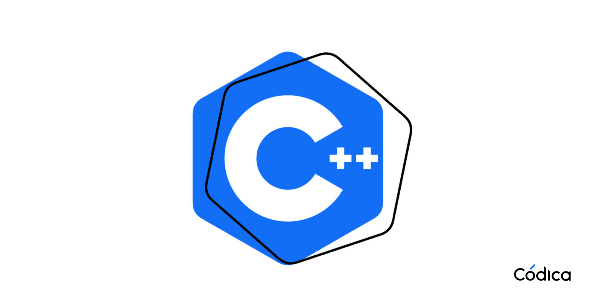

# Programación de Procesos en C

Actividades de PSP realizadas en Debian 13.

## Ejercicios
- **ejemplo_system.c**: uso de `system()` para ejecutar comandos de Linux.
- **actividad1_1.c**: `fork()`. El padre suma 5 y el hijo resta 5 a una variable.
- **actividad1_2.c**: `pipe()`. El hijo envía un mensaje al padre.
- **abuelo_hijo_nieto.c**: tres procesos que se comunican con dos pipes (resultado 27).
- **actividad1_3.c**: señales. El hijo envía 3 `SIGUSR1` y un `SIGKILL` al padre.

## Cómo compilar y ejecutar
    gcc nombre.c
    ./a.out

